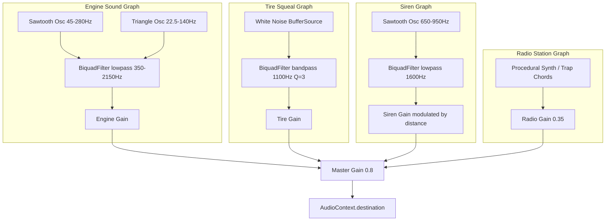

# Audio Synthesis & Sound Engine

## Overview
The audio architecture runs on **100% procedural Web Audio API synthesis**, achieving a **zero-asset footprint** with no external MP3/WAV files required. Sound generation covers engine RPM curves, tire squeal, gunfire acoustics, hit-marker chirps, dual-tone car horns, emergency police sirens, crash crunches, weapon reloading, and procedural multi-station radio music.

## Source Files
- Implementation: [`src/core/AudioManager.js`](file:///d:/My%20Side%20Projects/GTA%20online/src/core/AudioManager.js)
- Radio Wheel UI: [`src/ui/RadioWheel.js`](file:///d:/My%20Side%20Projects/GTA%20online/src/ui/RadioWheel.js)

---

## Synthesizer Architecture

---

## Sound Profiles & Synthesizer Parameters

### 1. Engine RPM Synthesizer (`updateEngine`)
- **Oscillator 1**: Sawtooth wave, fundamental frequency mapped dynamically:
  $$f_1 = 50 + 220 \times \text{rpmRatio}\quad (50\text{ Hz idle to }270\text{ Hz redline})$$
- **Oscillator 2**: Triangle sub-oscillator at half pitch ($f_2 = f_1 \times 0.5$) for low-end bass rumble.
- **Dynamic Low-pass Filter**: Sweeps from $350\text{ Hz}$ up to $2,150\text{ Hz}$ based on throttle load.
- **Volume**: Automatically mutes when the player exits the car.

### 2. Tire Drift & Squeal (`updateTires`)
- Looping procedural white noise buffer routed through a $1,100\text{ Hz}$ bandpass filter ($Q = 3.0$).
- Gain opens proportionally as lateral tire slip exceeds $0.25$:
  $$\text{gain} = \min((\text{slip} - 0.25) \times 1.5, 0.30)$$

### 3. Gunfire & Ballistics (`playGunshot`)
- **Muzzle Crack**: High-pass filtered noise burst ($1,200\text{ Hz}$ for pistol, $1,800\text{ Hz}$ for SMG) with fast exponential decay ($0.08\text{s}$ to $0.14\text{s}$).
- **Bass Thump**: Sine wave dropping exponentially from $140\text{ Hz}$ down to $30\text{ Hz}$ simulating explosive cartridge detonation.

### 4. Dual-Tone Automotive Horn (`playHorn`)
- Emulates mechanical diaphragm dual-tone automotive horns:
  - High tone: $440\text{ Hz}$ sawtooth oscillator.
  - Low tone: $350\text{ Hz}$ sawtooth oscillator.
- Modulated by a $26\text{ Hz}$ LFO ($\pm 4.5\text{ Hz}$ depth) through an $820\text{ Hz}$ bandpass filter.

### 5. Police Siren (`setSiren`, `setSirenVolume`)
- Modulated sawtooth oscillator alternating between $650\text{ Hz}$ and $950\text{ Hz}$ on a $500\text{ms}$ interval.
- Master siren volume is attenuated in real-time based on the distance to the closest pursuing cruiser:
  $$\text{vol} = \text{clamp}\left(1.1 - \frac{\text{dist}}{120}, 0.08, 1.0\right)$$

### 6. Crash Crunch & Metal Crumple (`playCrash`)
- Sweeping white noise burst filtered from $2,200\text{ Hz}$ down to $350\text{ Hz}$.
- Distorted bass triangle wave routed through a non-linear `WaveShaperNode` for mechanical impact crunch.
- Resonant metallic ring oscillator at $280\text{ Hz}$ simulating chassis vibration.

---

## Procedural In-Car Radio Stations

The in-game radio can be toggled via `[Q]` when inside any vehicle:

1. **Flash FM 102.9 (Synthwave)**:
   - 120 BPM retro chord progressions (Am $\rightarrow$ F $\rightarrow$ C $\rightarrow$ G) using sawtooth plucks.
   - Lowpass filter sweep ($1,400\text{ Hz} \rightarrow 300\text{ Hz}$).
   - 4-on-the-floor bass kick generator.
2. **Vice Wave 98.4 (Chillwave)**:
   - 95 BPM ambient sine pad chords with gentle envelope release.
3. **Leonida Trap 105.1 (808 Trap)**:
   - 130 BPM sub-bass 808 pitch slides ($55\text{ Hz}$ to $82\text{ Hz}$).
4. **Radio Off**:
   - Mutes background station playback.

---

## Implementation Status & Diff vs Code

| Feature | In Design Spec | In Code (`src/`) | Status |
|---|---|---|---|
| **Zero-Asset Procedural Web Audio** | No external MP3/WAV files required | Implemented in [`AudioManager.js`](file:///d:/My%20Side%20Projects/GTA%20online/src/core/AudioManager.js) | ✅ Implemented |
| **Engine RPM Synthesizer** | Dual sawtooth + triangle sub-oscillator & lowpass sweep | Implemented in [`AudioManager.js#L180-L245`](file:///d:/My%20Side%20Projects/GTA%20online/src/core/AudioManager.js#L180-L245) | ✅ Implemented |
| **Tire Squeal & Skid** | White noise buffer through 1100Hz bandpass filter | Implemented in [`AudioManager.js#L207-L260`](file:///d:/My%20Side%20Projects/GTA%20online/src/core/AudioManager.js#L207-L260) | ✅ Implemented |
| **Gunfire Acoustics & Reloading** | Muzzle crack, explosive bass drop, mechanical reload | Implemented in [`AudioManager.js#L164-L290`](file:///d:/My%20Side%20Projects/GTA%20online/src/core/AudioManager.js#L164-L290) | ✅ Implemented |
| **Dual-Tone Horn & Siren** | 440/350Hz horn, 650/950Hz siren with distance gain | Implemented in [`AudioManager.js#L347-L510`](file:///d:/My%20Side%20Projects/GTA%20online/src/core/AudioManager.js#L347-L510) | ✅ Implemented |
| **Crash Crunch & Metal Crumple** | WaveShaper distorted triangle + metallic resonance | Implemented in [`AudioManager.js#L403-L490`](file:///d:/My%20Side%20Projects/GTA%20online/src/core/AudioManager.js#L403-L490) | ✅ Implemented |
| **3 Procedural Radio Stations** | Flash FM (Synthwave), Vice Wave (Chillwave), Leonida Trap | Implemented in [`AudioManager.js#L550-L640`](file:///d:/My%20Side%20Projects/GTA%20online/src/core/AudioManager.js#L550-L640) | ✅ Implemented |
| **3D Web Audio Spatialization** | PannerNode 3D positional coordinates | Audio uses manual distance-to-gain attenuation formula | ⚠️ Diff (Manual attenuation) |
| **Footstep Sound Synthesizer** | Asphalt / sidewalk footstep audio | Humanoid movement is currently silent on foot | ❌ Not implemented |
| **Vehicle Mechanical SFX** | Door opens/slams, starter ignition click | Transitions are currently silent | ❌ Not implemented |

---

## TODO Items

- [ ] **3D Spatial PannerNode**: Upgrade one-shot sounds (gunfire, explosions, sirens) to use Web Audio `PannerNode` for accurate left/right stereo and surround panning.
- [ ] **Procedural Footsteps**: Add noise-burst footstep synthesizer synchronized with humanoid walk and sprint gait cycles.
- [ ] **Vehicle Entry & Ignition SFX**: Add metallic car door unlatch, heavy door slam, and engine ignition starter-motor crank sound.
- [ ] **Environmental Ambiance**: Add procedural ocean surf wave whoosh near beach ($z > 380$) and gentle city wind drone.
- [ ] **Bullet Whiz-By Audio**: Synthesize high-speed supersonic bullet snap when projectiles fly within 3 meters of player camera.
