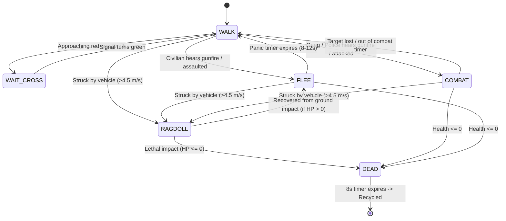

# Living City NPC & Pedestrian AI

## Overview
The pedestrian and NPC system simulates living civilians, hostile street gang members, and armed law enforcement officers. NPCs traverse an interconnected sidewalk graph, obey traffic signals at crosswalks, react realistically to gunfire and vehicular threats, engage in gun battles, experience ragdoll tumbling upon car collisions, and drop cash upon defeat.

## Source Files
- Pedestrian AI & Lifecycle: [`src/entities/PedestrianSystem.js`](file:///d:/My%20Side%20Projects/GTA%20online/src/entities/PedestrianSystem.js)
- Humanoid Model & Animations: [`src/entities/HumanoidModel.js`](file:///d:/My%20Side%20Projects/GTA%20online/src/entities/HumanoidModel.js)
- Sidewalk Grid & Crosswalks: [`src/world/CityLayout.js`](file:///d:/My%20Side%20Projects/GTA%20online/src/world/CityLayout.js)

---

## NPC Roles & Characteristics

| Role | Population % | Health | Armed | Weapon | Behavior |
|---|---|---|---|---|---|
| **Civilian** | ~80% | 75 HP | No | None | Walks sidewalks, flees in panic when gunshots occur or when attacked |
| **Gang Member** | ~20% | 100 HP | Yes | Combat Pistol | Red shirts, retaliates with gunfire when threatened, defends territory |
| **Police Officer** | Spawned via Wanted System | 120 HP | Yes | Combat Pistol | Blue uniform + hat, dismounts cruisers, pursues player, coordinates fire |

---

## State Machine Architecture

Every NPC is governed by a finite state machine updated at 60 FPS:

### State Details

1. **`WALK` (Ambient Sidewalk Traversal)**:
   - Navigates along the sidewalk graph (`layout.walkCoords`).
   - Picks random neighboring intersections avoiding immediate reversal.
   - Adjusts speed: $1.7\text{ to }2.4\text{ m/s}$.
   - Animates natural arm and leg swings with idle breathing.

2. **`WAIT_CROSS` (Signal Discipline)**:
   - Evaluated before stepping onto any roadway crosswalk segment.
   - Queries `layout.getLightState(crossAxis)`.
   - Pedestrians only step onto the asphalt when the cross-traffic light is green (perpendicular vehicular traffic is halted on red).

3. **`FLEE` (Civilian Panic)**:
   - Triggered by `alertGunshot(origin, radius = 38m)` or direct injury.
   - Calculates repulsive vector away from danger:
     $$\text{heading} = \text{atan2}(x_{\text{ped}} - x_{\text{origin}}, z_{\text{ped}} - z_{\text{origin}})$$
   - Sprints at $5.2\text{ m/s}$ with higher limb animation frequency.
   - Bounces off wall collisions to avoid getting cornered.

4. **`COMBAT` (Hostile Engagement)**:
   - Gang members and Police officers face the player:
     $$\theta_{\text{target}} = \text{atan2}(x_{\text{player}} - x_{\text{npc}}, z_{\text{player}} - z_{\text{npc}})$$
   - **Range > 22m**: Sprints toward player with weapon drawn.
   - **Range 9m–22m**: Advances with tactical strafe ($1.9\text{ m/s}$) while aiming weapon.
   - **Shooting**:
     - Tests line-of-sight against buildings using `colliders.hasLineOfSight()`.
     - Fires bursts every 0.6–1.5s with directional muzzle sparks, tracer lines, and audio.
     - Hit probability scales with distance:
       $$P_{\text{hit}} = \text{clamp}(0.62 - \text{dist} \times 0.012, 0.18, 0.58)$$
     - Inflicts 6–7 damage to player or damages player's vehicle.

5. **`RAGDOLL` (Vehicle Collision Mechanics)**:
   - Triggered when any vehicle strikes an NPC at $|v_{\text{car}}| \ge 4.5\text{ m/s}$.
   - Launches NPC into the air with velocity proportional to car momentum:
     $$v_x = \frac{\Delta x}{d} \times \min(0.85 \cdot |v_{\text{car}}|, 22), \quad v_y = 5.5 + \min(0.25 \cdot |v_{\text{car}}|, 6), \quad v_z = \frac{\Delta z}{d} \times \min(0.85 \cdot |v_{\text{car}}|, 22)$$
   - Spins on both X and Z axes ($7.0\text{ rad/s}$ and $5.0\text{ rad/s}$).
   - Bounces against ground surface and decelerates with friction.

6. **`DEAD` (Elimination & Economy)**:
   - Health drops to $\le 0$.
   - Drops to the floor (`mesh.rotation.x = -Math.PI / 2`).
   - Spawns a floating green cash bundle ($45 for civilians, $120 for gang members).
   - Cash bundles rotate on the Y-axis and are auto-collected when the player walks within 2.0m.
   - Dead body is recycled after 8 seconds to preserve memory and frame rate.

---

## Implementation Status & Diff vs Code

| Feature | In Design Spec | In Code (`src/`) | Status |
|---|---|---|---|
| **NPC Roles & Health Pools** | Civilian (75 HP), Gang (100 HP), Police (120 HP) | Implemented in [`PedestrianSystem.js#L75-L100`](file:///d:/My%20Side%20Projects/GTA%20online/src/entities/PedestrianSystem.js#L75-L100) | ✅ Implemented |
| **Sidewalk Traversal & Crosswalks** | Intersections, traffic light checks on road crossings | Implemented in [`PedestrianSystem.js#L180-L240`](file:///d:/My%20Side%20Projects/GTA%20online/src/entities/PedestrianSystem.js#L180-L240) | ✅ Implemented |
| **Panic & Flee Mechanics** | Gunshot radius alerts (38m) causing flee | Implemented in [`PedestrianSystem.js#L125-L135`](file:///d:/My%20Side%20Projects/GTA%20online/src/entities/PedestrianSystem.js#L125-L135) | ✅ Implemented |
| **Hostile Gang & Police Combat** | Tactical strafe, line-of-sight checks, gunfire bursts | Implemented in [`PedestrianSystem.js#L260-L330`](file:///d:/My%20Side%20Projects/GTA%20online/src/entities/PedestrianSystem.js#L260-L330) | ✅ Implemented |
| **Car Hit Ragdoll Physics** | Impact fling at $> 4.5\text{ m/s}$ with angular tumbling | Implemented in [`PedestrianSystem.js#L340-L370`](file:///d:/My%20Side%20Projects/GTA%20online/src/entities/PedestrianSystem.js#L340-L370) | ✅ Implemented |
| **Cash Drops & Despawn Timers** | Civilians (\$45), Gangsters (\$120), 8s corpse recycling | Implemented in [`PedestrianSystem.js#L139-L166`](file:///d:/My%20Side%20Projects/GTA%20online/src/entities/PedestrianSystem.js#L139-L166) | ✅ Implemented |
| **NPC Weapon Variety** | Variety of firearms for hostile NPCs | Armed NPCs currently only wield the Combat Pistol | ⚠️ Diff (Only Pistol in code) |
| **Pedestrian Audio Cues** | Screams, pain grunts, and banter | No vocal audio synthesized for NPCs | ❌ Not implemented |

---

## TODO Items

- [ ] **NPC Weapon Variety**: Equip gang members with Micro SMGs and shotguns based on spawn district danger tiers.
- [ ] **Procedural Voice & Screams**: Add procedural Web Audio voice synthesis for panic screams, pain grunts, and combat callouts.
- [ ] **Ambient Civilian Activities**: Implement idle animations (sitting on park benches, smoking, talking in pairs, window shopping).
- [ ] **Windshield Ragdoll Ejection**: When AI traffic cars crash head-on at high speed, launch driver humanoid through the front windshield.
- [ ] **Pedestrian Companion / Bodyguard AI**: Allow player to recruit friendly gang members who follow, enter passenger seats, and provide covering fire.
