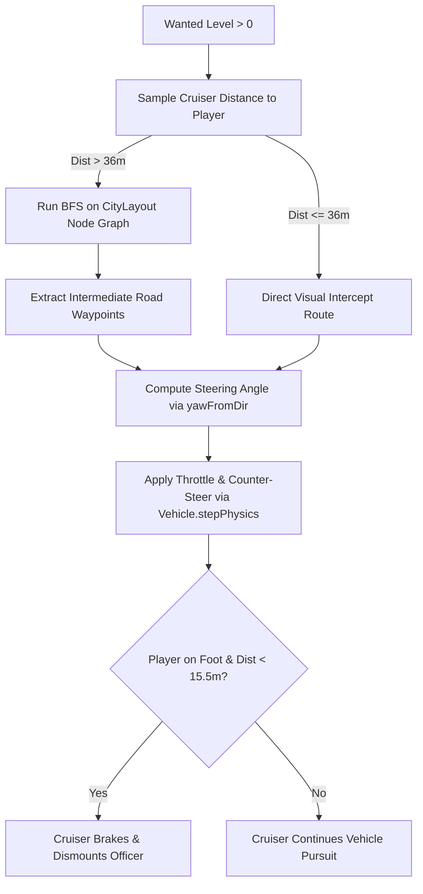

# Police Pursuit, Wanted Level & Law Enforcement

## Overview
The Police and Law Enforcement system handles crime detection, 0-to-5-star wanted levels, emergency cruiser dispatch with siren audio and flashing lightbars, BFS road network pursuit pathfinding, tactical officer dismounts, and distance/line-of-sight evasion mechanics.

## Source Files
- Police Logic & Cruiser Dispatch: [`src/entities/PoliceSystem.js`](file:///d:/My%20Side%20Projects/GTA%20online/src/entities/PoliceSystem.js)
- Police Cruiser Vehicle Archetype: [`src/entities/VehicleModels.js`](file:///d:/My%20Side%20Projects/GTA%20online/src/entities/VehicleModels.js)
- Officer Humanoid Rig: [`src/entities/HumanoidModel.js`](file:///d:/My%20Side%20Projects/GTA%20online/src/entities/HumanoidModel.js), [`src/entities/PedestrianSystem.js`](file:///d:/My%20Side%20Projects/GTA%20online/src/entities/PedestrianSystem.js)
- Wanted Stars HUD Display: [`src/ui/HUD.js`](file:///d:/My%20Side%20Projects/GTA%20online/src/ui/HUD.js)

---

## Wanted Level Progression & Crime Scoring

Crimes add points to `crimePoints`, which dynamically scales `wantedLevel` (1 to 5 stars):

| Crime Action | Crime Points | Typical Wanted Stars Triggered |
|---|---|---|
| Firing a weapon in public | +1 point | ★☆☆☆☆ |
| Hijacking a civilian vehicle | +1 point | ★☆☆☆☆ |
| Assaulting / striking a pedestrian | +1 point | ★☆☆☆☆ |
| Vehicular manslaughter (running over pedestrian) | +2 points | ★★☆☆☆ |
| Eliminating a gang member | +2 points | ★★☆☆☆ |
| Hijacking a police interceptor | +3 points | ★★★☆☆ |
| Detonating a vehicle explosion | +3 points | ★★★☆☆ |
| Eliminating a police officer | +4 points | ★★★★☆ to ★★★★★ |

### Wanted Star Tiers
- **0 Stars (Clean)**: No police presence; sirens muted.
- **1 Star (Infraction)**: 1 Cruiser dispatched to investigate last reported position.
- **2 Stars (Misdemeanor)**: 2 Cruisers in active pursuit; officers engage with sidearms.
- **3 Stars (Felony)**: 3 Cruisers deployed; aggressive vehicle ramming; rapid path recalculation.
- **4–5 Stars (Maximum Threat)**: 4 Cruisers actively hunt player; continuous officer reinforcement; relentless pursuit.

---

## AI Cruiser Navigation & Pathfinding

Unlike simple linear chasing, police cruisers drive according to true vehicle physics and adhere to the city's road network:

### 1. Multi-Route Tactical BFS Pathfinding
When cruisers are further than 42 meters away **or** lack direct building line-of-sight (`!colliders.hasLineOfSight`), they compute road-graph paths (`findTacticalPath(fromId, toId, occupiedNodes)`) and follow right-hand lane offsets (`LANE_OFFSETS`). Secondary cruisers penalize road nodes already claimed by the lead cruiser so they naturally flank from parallel streets instead of forming a single-file pile-up.

### 2. Squad Roles, Formation Slots & Avoidance
Active cruisers are dynamically sorted by proximity and assigned one of four tactical roles (`TAIL`, `FLANK_LEFT`, `FLANK_RIGHT`, `INTERCEPT`):
- **Vehicle Pursuit (`PURSUIT` Mode)**:
  - **1–2 Stars**: Controlled pacing speed (`78%–88%` max speed); the `TAIL` cruiser maintains a safe following distance behind the player while flankers pull alongside without reckless head-on ramming.
  - **3+ Stars**: Full interceptor speed; `TAIL` targets the rear quarter panel for PIT maneuvers, `FLANK_LEFT` and `FLANK_RIGHT` pinch lateral escape lanes, and `INTERCEPT` leads the player's velocity vector (`playerPos + playerVel * lookahead`) to cut off intersections.
- **Perimeter Standoff (`PERIMETER` Mode)**:
  - When the player is on foot or stationary (`speed < 3.5 m/s`), cruisers claim distinct angular slots on a `13–16m` standoff arc around the player and progressively brake inside `30m` so they never kamikaze into the player or each other.
- **Multi-Layer Obstacle & Friendly-Fire Avoidance (`computeAvoidance`)**:
  - **Cruiser-to-Cruiser Separation**: Forward corridor detection and lateral separation bubbles prevent police cars from rear-ending or sideswiping fellow cruisers (both active and dismounted).
  - **Friendly Officer Protection**: Cruisers brake and steer around dismounted `police` officers on foot.
  - **3-Feeler Wall Raycasts**: Left, center, and right whisker raycasts (`colliders.raycast`) steer cruisers away from building corners and static props before impact.

### 3. Tactical Officer Dismount & Foot Combat
If the player is on foot and a cruiser brakes into perimeter range (`dist < 18.5m`, `speed < 7.5 m/s`) with line-of-sight:
1. The cruiser locks its handbrake at its perimeter slot.
2. An armed Police Officer NPC spawns on the safe door side.
3. Foot officers in `COMBAT` maintain `3.75m` squad spacing from fellow officers, hold an optimal `10–18m` firing line, backpedal if the player gets within `7.5m`, strafe laterally while aiming, and sidestep perpendicular to oncoming vehicles.

---

## Evasion & Search Radius

- **Pursuit Range**: Police maintain active search while within 62 meters of the player.
- **Evasion State**:
  - When the player breaks line-of-sight and exceeds a distance of 62 meters from all active cruisers and officers, the HUD stars start flashing blue/gray, indicating the police have lost contact.
  - If the player remains outside the search radius for **10 seconds** (code implementation: `evasionTimer >= 10.0s`), the wanted level decrements by 1 star and removes 5 crime points.
  - When stars reach 0, all pursuing cruisers are recalled and the search is cancelled.

---

## Implementation Status & Diff vs Code

| Feature | In Design Spec | In Code (`src/`) | Status |
|---|---|---|---|
| **Evasion Timer Duration** | Stated as 12 seconds in early draft | Implemented as `10.0` seconds in [`PoliceSystem.js#L222`](file:///d:/My%20Side%20Projects/GTA%20online/src/entities/PoliceSystem.js#L222) | ⚠️ Diff (10s in code vs 12s in draft) |
| **Cruiser AI & BFS Pathfinding** | BFS road-graph navigation & vehicle physics | Implemented in [`PoliceSystem.js#L140-L210`](file:///d:/My%20Side%20Projects/GTA%20online/src/entities/PoliceSystem.js#L140-L210) | ✅ Implemented |
| **Tactical Dismounts** | Cruisers brake and deploy armed foot officers | Implemented in [`PoliceSystem.js#L155-L167`](file:///d:/My%20Side%20Projects/GTA%20online/src/entities/PoliceSystem.js#L155-L167) | ✅ Implemented |
| **Crime Scoring & 1–5 Stars** | Crimes scale stars from 1 to 5 | Implemented in [`PoliceSystem.js#L27-L40`](file:///d:/My%20Side%20Projects/GTA%20online/src/entities/PoliceSystem.js#L27-L40) | ✅ Implemented |
| **Cruiser Fleet Scaling** | Up to 4 active cruisers pursuing player | Implemented in [`PoliceSystem.js#L72`](file:///d:/My%20Side%20Projects/GTA%20online/src/entities/PoliceSystem.js#L72) | ✅ Implemented |
| **Roadblocks & Spike Strips** | Mentioned in high-level pursuit designs | Not implemented in cruiser AI | ❌ Not implemented |
| **SWAT / Enforcer Heavy Vans** | Mentioned in high-tier pursuits | Cruisers only spawn standard LSPD Interceptors | ❌ Not implemented |
| **Air Support (Police Helicopter)** | Mentioned in 5-star response | No air units or searchlights implemented | ❌ Not implemented |

---

## TODO Items

- [ ] **Evasion Timing Synchronization**: Keep code at 10.0s and ensure documentation aligns.
- [ ] **Police Roadblocks**: Implement barricade cruiser spawns across major avenue intersections at 3+ Wanted Stars.
- [ ] **Tire Spike Strips**: Deploy deployable spike strips that burst tires and severely degrade vehicle handling.
- [ ] **SWAT Enforcer Heavy Van**: Add armored tactical van archetype deployed at 4 Wanted Stars with heavy armored officers.
- [ ] **Police Surveillance Helicopter**: Add airborne chopper with moving searchlight spotlighting player at 5 Wanted Stars.
- [ ] **Arrest / Busted Mechanic**: Trigger "BUSTED" state if unmounted police surround an on-foot player with low health or zero escape velocity.
