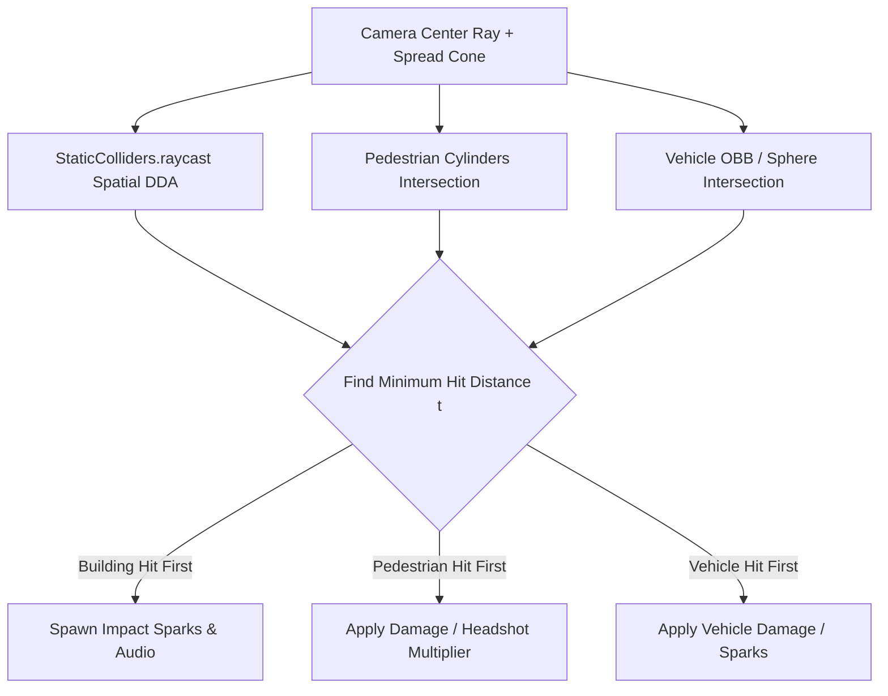

# Combat & Weapons System

## Overview
The weapon system implements third-person raycast gunplay, center-screen crosshairs, magazine clips with manual and auto-reloading, distance falloff, weapon spread, procedural camera recoil, bullet tracers, surface impact effects, and damage occlusion against world geometry.

## Source Files
- Weapon Management & Raycasting: [`src/combat/WeaponSystem.js`](file:///d:/My%20Side%20Projects/GTA%20online/src/combat/WeaponSystem.js)
- Visual Effects (Sparks, Blood, Smoke, Explosions): [`src/combat/ImpactEffects.js`](file:///d:/My%20Side%20Projects/GTA%20online/src/combat/ImpactEffects.js)
- Audio Synthesizer: [`src/core/AudioManager.js`](file:///d:/My%20Side%20Projects/GTA%20online/src/core/AudioManager.js)

---

## Arsenal & Ballistics Specification

The player can carry up to 5 weapons simultaneously, switched using keys `[1]` through `[5]` or the mouse wheel.

| Slot | Weapon | Damage | Range ($m$) | Fire Rate | Pellets | Spread ($\text{rad}$) | Mag Size | Max Reserve | Reload ($s$) | Fire Mode |
|---|---|---|---|---|---|---|---|---|---|---|
| **1** | **Unarmed / Fists** | 34 | 2.3 | 0.42s | 1 | 0.000 | $\infty$ | $\infty$ | 0.0s | Melee Swing |
| **2** | **Combat Pistol** | 38 | 95 | 0.22s | 1 | 0.012 | 12 | 120 | 1.1s | Semi-Auto |
| **3** | **Micro SMG** | 24 | 80 | 0.095s | 1 | 0.028 | 30 | 240 | 1.35s | Full-Auto |
| **4** | **Pump Shotgun** | 18 / pellet | 42 | 0.78s | 7 | 0.068 | 8 | 64 | 1.6s | Semi-Auto Spread |
| **5** | **Carbine Rifle** | 34 | 135 | 0.11s | 1 | 0.015 | 30 | 270 | 1.5s | Full-Auto |

---

## Raycasting & Occlusion Architecture

Unlike naive distance-based checks, `castBulletRay()` implements line-of-sight occlusion across three entity categories:

### 1. Solid Building Occlusion
The spatial-hash DDA raycast tests against all static building and prop colliders. If a skyscraper or concrete wall intersects the ray at distance $t_{\text{wall}} < t_{\text{target}}$, the bullet hits the wall, spawning yellow spark particles, and completely shields entities behind it.

### 2. Pedestrian Hitboxes & Headshots
- **Body Hitbox**: Vertical cylinder with radius $r = 0.42m$, height $h = 1.85m$ starting at the entity's foot level.
- **Headshot Detection**:
  If the ray intersection height $y_{\text{hit}} \ge y_{\text{feet}} + 1.38m$, the hit qualifies as a headshot:
  $$\text{Damage}_{\text{final}} = \text{Damage}_{\text{base}} \times 2.2$$
- Triggers red blood droplet particle bursts via `ImpactEffects.createBloodSplatter()`.

### 3. Vehicle Hitboxes & Destruction Chain
- Vehicles check against oriented half-extents ($w \times l \times h$).
- Damaging a car reduces its health pool; upon reaching zero, it triggers a chain explosion damaging all entities within 9 meters.

---

## Recoil & Camera Shake

Firing automatic or heavy weapons applies physical camera displacement:
- **Pitch Kick**: Adds immediate upward pitch impulse to `CameraController.pitch`:
  $$\Delta\text{pitch} = +\text{recoil}$$
- **Horizontal Jitter**: Random deviation along the yaw axis:
  $$\Delta\text{yaw} = (\text{rand}() - 0.5) \times \text{recoil} \times 0.7$$
- **Screen Trauma**: High-caliber rounds (such as Shotgun pellets) add screen shake with exponential decay:
  $$\text{shake} \leftarrow \min(1.2, \text{shake} + \text{amount})$$

---

## Magazine & Reload Loop

1. Firing decrements `wep.clip`.
2. When `clip == 0`:
   - If `wep.reserve > 0`, auto-reload is scheduled after 160ms.
   - If `wep.reserve == 0`, a dry-fire metallic click audio cue plays.
3. Manual reload can be initiated anytime via `[R]`:
   - Checks if clip is not full and reserve ammo exists.
   - Triggers procedural slide/magazine insertion audio.
   - Locks weapon firing for the duration of `wep.reloadTime`.
   - Transfers $\min(\text{magSize} - \text{clip}, \text{reserve})$ from reserve into clip.

---

## Implementation Status & Diff vs Code

| Feature | In Design Spec | In Code (`src/`) | Status |
|---|---|---|---|
| **5 Arsenal Slots & Balistics** | Fists, Pistol, SMG, Shotgun, Rifle | Implemented in [`WeaponSystem.js#L14-L60`](file:///d:/My%20Side%20Projects/GTA%20online/src/combat/WeaponSystem.js#L14-L60) | ✅ Implemented |
| **Spatial DDA Building Occlusion** | Raycast tests against static wall colliders | Implemented in [`WeaponSystem.js#L260-L310`](file:///d:/My%20Side%20Projects/GTA%20online/src/combat/WeaponSystem.js#L260-L310) | ✅ Implemented |
| **Pedestrian Hitboxes & Headshots** | $y \ge y_{\text{feet}} + 1.38m \implies \times 2.2$ damage | Implemented in [`WeaponSystem.js#L320-L350`](file:///d:/My%20Side%20Projects/GTA%20online/src/combat/WeaponSystem.js#L320-L350) | ✅ Implemented |
| **Vehicle Hitboxes & Explosions** | Damage applied to car HP, triggers chain explosion | Implemented in [`WeaponSystem.js#L360-L380`](file:///d:/My%20Side%20Projects/GTA%20online/src/combat/WeaponSystem.js#L360-L380) | ✅ Implemented |
| **Recoil, Jitter & Camera Shake** | Pitch kick, yaw jitter, trauma accumulation | Implemented in [`WeaponSystem.js#L210-L240`](file:///d:/My%20Side%20Projects/GTA%20online/src/combat/WeaponSystem.js#L210-L240) | ✅ Implemented |
| **Magazines, Reserves & Reload** | Auto and manual `[R]` reloading | Implemented in [`WeaponSystem.js#L160-L195`](file:///d:/My%20Side%20Projects/GTA%20online/src/combat/WeaponSystem.js#L160-L195) | ✅ Implemented |
| **Throwables & Explosives** | Grenades / Molotovs | Not implemented | ❌ Not implemented |
| **NPC Weapon & Ammo Drops** | Armed enemies drop guns or ammo boxes | Enemies only drop cash bundles in [`PedestrianSystem.js`](file:///d:/My%20Side%20Projects/GTA%20online/src/entities/PedestrianSystem.js) | ❌ Not implemented |

---

## TODO Items

- [ ] **Throwable Explosives**: Add frag grenades and sticky explosives with parabolic ballistic arc throw physics and timed detonation.
- [ ] **Ammo / Weapon Pickups**: Allow defeated armed gangsters and police officers to drop weapon ammo clips and firearm pickups.
- [ ] **Sniper Rifle with Scope Overlay**: Add long-range precision rifle with variable zoom lens, reticle overlay, and high velocity.
- [ ] **Heavy Rocket Launcher (RPG)**: Add shoulder-fired unguided rocket projectile with physical rocket mesh, smoke trail, and high-yield explosion.
- [ ] **Weapon Wheel Quick-Select**: Support holding `[Tab]` to display a radial weapon wheel pause/slowdown selector.
