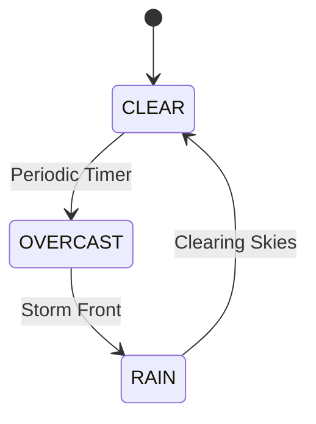

# Dynamic Day/Night Cycle & Weather System

## Overview
The environment atmosphere engine simulates a continuous, periodic 24-hour diurnal cycle (Dawn, Daylight, Golden Hour Sunset, and Night) coupled with a periodic weather state machine (`CLEAR`, `OVERCAST`, `RAIN`). It dynamically drives celestial orbital mechanics, sky dome shader palettes, procedural night starfields, exponential fog density, ocean water reflections, street lamp illumination, wet-road tire grip physics, and automatic vehicle headlights at night.

## Source Files
- Sky, Celestial Orbit, Fog, Ocean & Rain Engine: [`src/world/SkyAndLighting.js`](file:///d:/My%20Side%20Projects/GTA%20online/src/world/SkyAndLighting.js)
- Street Lamp Night Illumination: [`src/world/Props.js`](file:///d:/My%20Side%20Projects/GTA%20online/src/world/Props.js)
- Automatic Night Vehicle Headlights: [`src/entities/Vehicle.js`](file:///d:/My%20Side%20Projects/GTA%20online/src/entities/Vehicle.js)
- HUD Clock & Weather Readout: [`src/ui/HUD.js`](file:///d:/My%20Side%20Projects/GTA%20online/src/ui/HUD.js)

---

## 1. Diurnal Day/Night Cycle Formulation

In-game time $t \in [0, 24)$ hours advances continuously at a relaxed real-time period $T_{\text{day}} = 360\text{ s}$ (6 minutes per full 24-hour cycle, or $4\text{ game minutes per real second}$):

$$t \leftarrow \left(t + \frac{24}{T_{\text{day}}} \cdot \Delta t\right) \bmod 24$$

### Solar & Lunar Orbital Kinematics
The solar elevation angle $\alpha$ is mapped so sunrise occurs at $06:00$, solar zenith at $12:00$, sunset at $18:00$, and midnight nadir at $00:00$:

$$\alpha = \frac{t - 6}{24} \cdot 2\pi, \quad h_{\text{sun}} = \sin(\alpha)$$

| Phase | Time Window | Elevation $h_{\text{sun}}$ | Sky Zenith / Horizon | Directional Light | Auto Headlights & Street Lamps |
|---|---|---|---|---|---|
| **Dawn / Sunrise** | `05:45 – 07:15` | $-0.06 \le h \le 0.32$ | Indigo `#1d2951` $\rightarrow$ Peach `#f4a261` | Warm Amber (`1.1`) | Transitioning Off |
| **Daylight** | `07:15 – 17:30` | $h > 0.32$ | Azure `#2d7ad6` $\rightarrow$ Cream `#e6dcc5` | Bright Sun (`2.0`) | **OFF** (Manual `[H]` allowed) |
| **Sunset / Dusk** | `17:30 – 18:30` | $-0.06 \le h \le 0.32$ | Deep Purple `#1d2951` $\rightarrow$ Sunset Orange `#e76f51` | Golden Sun (`1.0`) | Transitioning On |
| **Night** | `18:30 – 05:45` | $h < -0.06$ | Midnight `#040711` $\rightarrow$ Navy `#131c31` + Stars | Cool Moon (`0.42`) | **AUTO-ON** |

---

## 2. Automatic Night Headlights & Street Lamps

### Vehicle Auto-Headlights (`Vehicle.updateAutoHeadlights`)
- Every vehicle tracks diurnal state transitions (`_lastAutoNight`).
- When night falls (`isNight === true`, i.e., $t \ge 18.5$ or $t < 5.8$):
  - All active traffic cars, police cruisers, and the player's vehicle **automatically switch their headlights ON**, activating dual volumetric light cones, ground projection decals, and the forward `THREE.SpotLight`.
- When daylight breaks (`isNight === false`):
  - Vehicles **automatically switch their headlights OFF** to conserve daytime visibility.
- **Manual Override**: While driving at any time of day or night, pressing `[H]` (or `[L]`) toggles the player vehicle's headlights manually until the next day/night transition.

### Instanced Street Lamps & Ground Illumination (`Props.updateNightLights`)
- Street lamp fixtures across all city blocks feature:
  - High-intensity luminaire bulbs (`0xfff6b8`) illuminated at night.
  - Soft volumetric downward light beams (`streetLampBeamMesh`) rendered with the shared beam shader (see below).
  - Soft 8.5m circular ground light pool decals (`streetLampPoolMesh`) mapped with radial falloff textures directly under every street lamp.
  - Proximity-based dynamic `THREE.PointLight` attached to the nearest street lamp to illuminate player vehicle paint and surroundings.

### Soft Volumetric Beam Shader (`createLightBeamMaterial`)
- Shared by street lamps and vehicle headlights: [`LightBeamMaterial.js`](file:///d:/My%20Side%20Projects/GTA%20online/src/world/LightBeamMaterial.js).
- Open `ConeGeometry` + additive `ShaderMaterial` (supports `InstancedMesh`), so beams read as glowing haze, not solid cones:
  - **Length falloff**: bright at the bulb, fading to zero at the far end (uses cone `uv.y`, so the base never draws a hard ring on the road).
  - **Edge falloff**: `pow(|N·V|, k)` makes the cone silhouette vanish.
  - **Near-camera fade**: avoids haze filling the screen when the camera passes through a beam.
  - `fog: false`: fogged additive surfaces turned grey at night, which caused the "grey triangle" look.
- Intensity is driven by the `uIntensity` uniform (street lamps scale it with `nightFactor`).

### Dynamic Building Window Illumination (`CityGenerator.updateNightLights`)
- Building facades use a procedural 8×8 multi-window atlas ($512 \times 512\text{px}$, 64 distinct window variations) with dedicated `map` and `emissiveMap` textures.
- Features realistic sparse distribution: only ~25% of windows are illuminated at night with varied warm amber, incandescent gold, modern office white, and dim room tones, while ~75% remain unlit/dark.
- Per-building and per-facade 3D spatial hashing in `GeoBuilder.box` offsets UV coordinates, ensuring every building across the skyline has a unique, non-repeating pattern of lit and dark windows.
- Non-window surfaces (roofs, trims, curbs) strictly map to non-emissive margin UVs.
- Window `emissiveIntensity` scales smoothly up to `0.95` at night, avoiding washed-out glare.

---

## 3. Periodic Weather State Machine

Weather transitions automatically on a periodic timer ($65\text{–}90\text{ s}$ per phase) or on demand via `[T]`:

| Weather State | Fog Density | Cloud / Sky Tint | Precipitation FX | Road Surface Grip Multiplier |
|---|---|---|---|---|
| `CLEAR` | `0.0012` | Crisp sky gradient & stars at night | None | `1.00` (Dry asphalt) |
| `OVERCAST` | `0.0020` | Desaturated slate-gray cloud cover | None | `0.95` |
| `RAIN` | `0.0028` | Dark storm canopy + reduced sun intensity | 450 3D falling rain streaks around camera | `0.82` (Wet asphalt drift slip) |

---

## Implementation Status & Diff vs Code

| Feature | In Design Spec | In Code (`src/`) | Status |
|---|---|---|---|
| **Periodic 24-Hour Day/Night Cycle** | Continuous time progression, sun/moon orbit, sky & fog interpolation | Implemented in [`SkyAndLighting.js`](file:///d:/My%20Side%20Projects/GTA%20online/src/world/SkyAndLighting.js) | ✅ Implemented |
| **Procedural Night Starfield** | Shader starfield visible on sky dome at night | Implemented in [`SkyAndLighting.js`](file:///d:/My%20Side%20Projects/GTA%20online/src/world/SkyAndLighting.js) | ✅ Implemented |
| **Auto Night Vehicle Headlights** | Headlights auto-enable at night and auto-disable at daybreak | Implemented in [`Vehicle.js`](file:///d:/My%20Side%20Projects/GTA%20online/src/entities/Vehicle.js) & [`main.js`](file:///d:/My%20Side%20Projects/GTA%20online/src/main.js) | ✅ Implemented |
| **Street Lamp Night Glow** | Instanced street lamp bulbs illuminate at night | Implemented in [`Props.js`](file:///d:/My%20Side%20Projects/GTA%20online/src/world/Props.js) | ✅ Implemented |
| **Periodic Weather & 3D Rain FX** | `CLEAR` / `OVERCAST` / `RAIN` cycle, falling rain streaks, wet road grip | Implemented in [`SkyAndLighting.js`](file:///d:/My%20Side%20Projects/GTA%20online/src/world/SkyAndLighting.js) | ✅ Implemented |
| **HUD Clock & Weather Indicator** | Live 24h digital clock & weather icon in top-left HUD + `[T]` time skip | Implemented in [`HUD.js`](file:///d:/My%20Side%20Projects/GTA%20online/src/ui/HUD.js) | ✅ Implemented |

---

## TODO Items

- [x] **Periodic Day / Night Cycle**: Continuously transition between dawn, day, sunset, and starry night with sun/moon orbital lighting.
- [x] **Automatic Night Headlights**: Automatically turn on player and AI vehicle headlights at dusk and turn them off at daybreak.
- [x] **Periodic Weather & Rain System**: Cycle through clear, overcast, and rain states with 3D rain particles and wet road physics.
- [ ] **Thunder & Lightning Flashes**: Add procedural thunderclap audio synthesis and brief sky-wide exposure flashes during heavy rainstorms.
- [ ] **Dynamic Puddle Planar Reflections**: Modulate road asphalt roughness maps with localized reflective puddles during and after rain.
